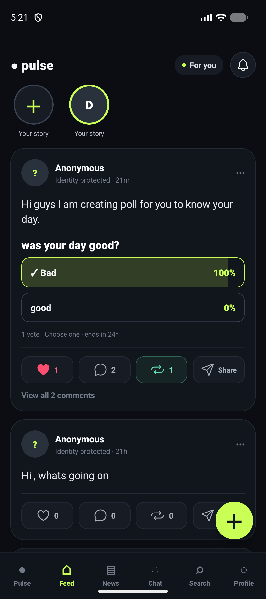
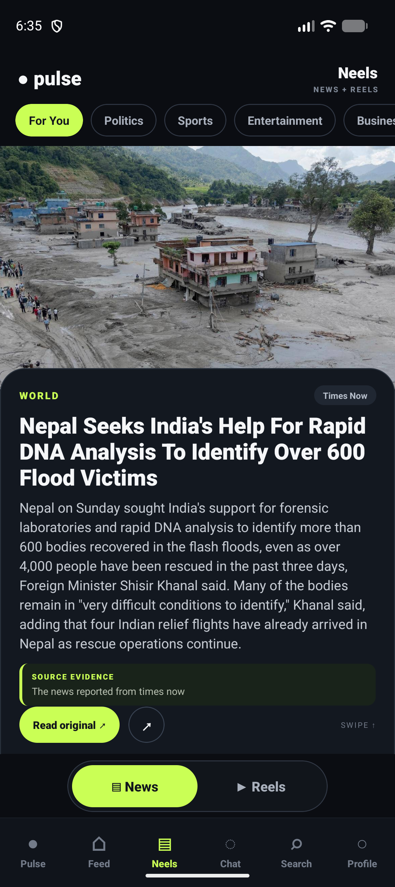
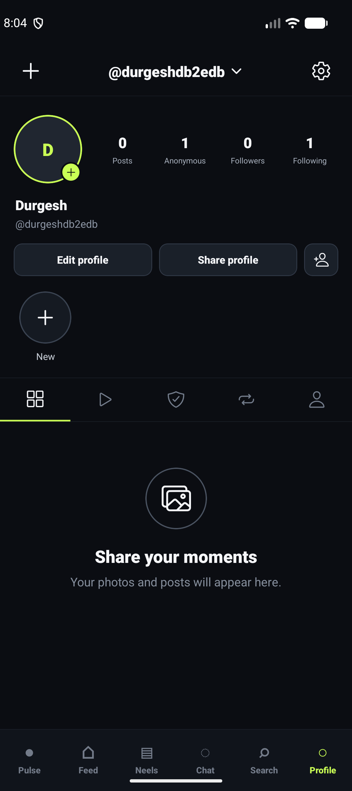
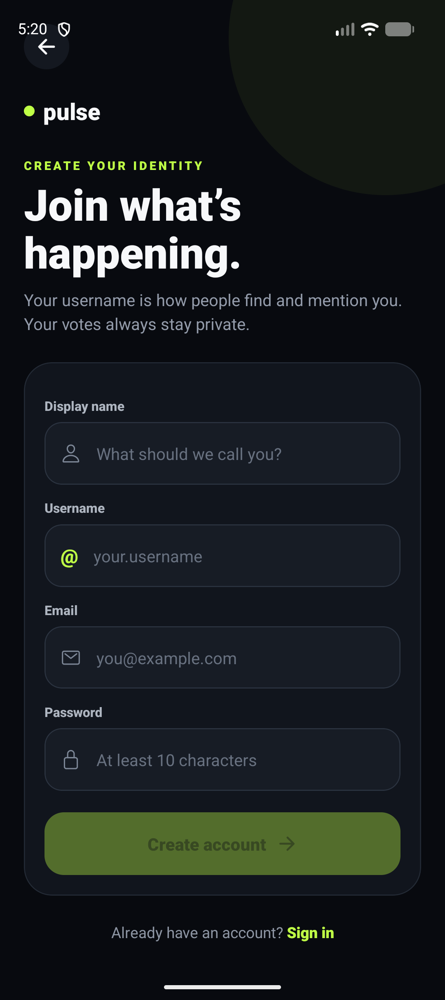
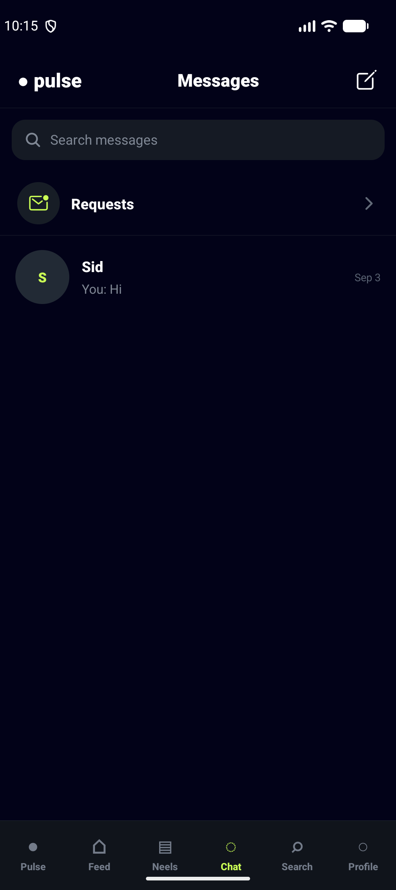
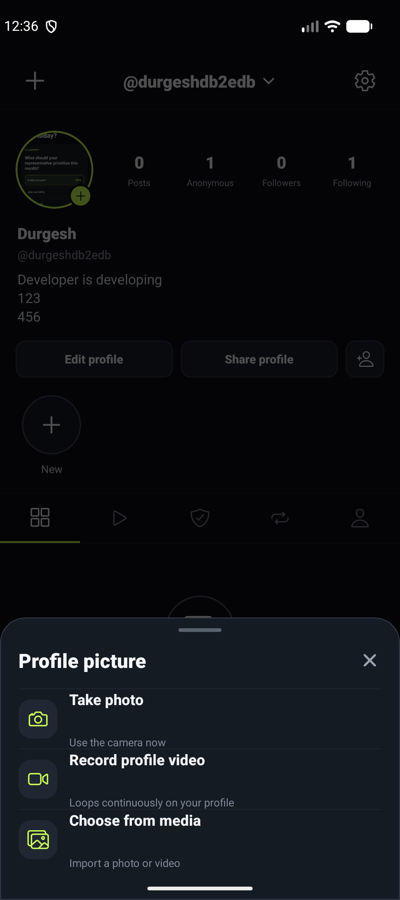
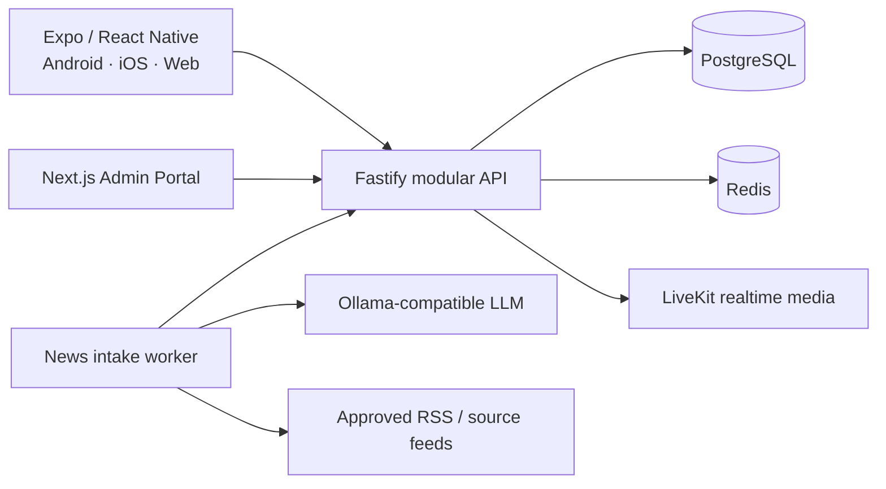

<div align="center">

# SidCraft

### A mobile-first social network for communities, live conversations, public opinion, and source-linked news.

Built with Expo, React Native, Next.js, Fastify, PostgreSQL, Redis, LiveKit, and an optional Ollama-powered news workflow.

</div>

## Product preview

<table>
  <tr>
    <td align="center"></td>
    <td align="center"></td>
    <td align="center"></td>
  </tr>
  <tr>
    <td align="center"><strong>Social feed</strong></td>
    <td align="center"><strong>News + reels</strong></td>
    <td align="center"><strong>Profiles</strong></td>
  </tr>
  <tr>
    <td align="center"></td>
    <td align="center"></td>
    <td align="center"></td>
  </tr>
  <tr>
    <td align="center"><strong>Identity & onboarding</strong></td>
    <td align="center"><strong>Private messaging</strong></td>
    <td align="center"><strong>Photo & video tools</strong></td>
  </tr>
</table>

The gallery represents the main user journeys. The repository also contains the responsive administration portal for publishing, verification, moderation, analytics, notifications, user management, platform configuration, and auditable AI-news review.

## What SidCraft includes

- Instagram-style social feed with posts, media carousels, likes, comments, reposts, follows, polls, stories, and live sessions.
- Photo/video capture and browser-safe uploads across posts, stories, reels, profiles, and chat.
- Full-screen News + Reels experience with topic categories and source-evidence links.
- Direct messaging, media attachments, voice notes, and LiveKit-powered calls.
- Profile grids, reels, highlights, followers/following, verification badges, anonymous activity, and settings.
- Location-aware public-opinion polls with privacy-preserving aggregate results.
- Administrative controls for users, content, moderation, verification, notifications, analytics, monetization, and audit logs.
- AI-assisted news intake with RSS/source management, duplicate detection, media extraction, summarization, and human approval before publishing.

> SidCraft never represents an article as verified without stored evidence and source links. News ingestion does not bypass publisher permissions, and AI-generated drafts require human review.

## Architecture



The codebase is intentionally organized as a modular monolith: shared contracts and database code stay reusable without adding distributed-system complexity prematurely.

## Repository structure

```text
apps/
  mobile/       Expo Router application for Android, iOS, and web
  admin/        Next.js administration and trust/safety portal
  api/          Fastify API and application services
packages/
  contracts/    Shared Zod schemas and TypeScript contracts
  database/     Drizzle schema, migrations, and PostgreSQL client
scripts/        Operational and development helpers
docs/           Product, architecture, data, and deployment documentation
ops/            Infrastructure and deployment configuration
```

## Technology

| Layer | Stack |
| --- | --- |
| User application | Expo 54, React Native, Expo Router, React Native Web |
| Admin portal | Next.js, React, server actions |
| API | Fastify, Zod, JWT, rate limiting |
| Persistence | PostgreSQL, Drizzle ORM, Redis |
| Realtime | LiveKit |
| AI/news workflow | Ollama-compatible models, RSS/Atom ingestion, human review |
| Tooling | TypeScript, pnpm workspaces, Turborepo, Vitest, Docker Compose |

## Local development

### Requirements

- Node.js 20+
- pnpm 10+
- Docker Desktop or another Docker-compatible runtime
- Android Studio for the Android emulator (optional)

### Setup

```powershell
git clone <your-repository-url>
cd sidcraft
Copy-Item .env.example .env
pnpm install
docker compose up -d
pnpm --filter @pulse/database db:migrate
pnpm --filter @pulse/database db:seed
pnpm dev
```

Default local endpoints:

- User web application: `http://localhost:8082`
- Admin portal: `http://localhost:3001`
- API: `http://localhost:4000`
- LiveKit: `ws://localhost:7880`

Android emulators reach services on the Windows host through `10.0.2.2`. For physical devices, set `EXPO_PUBLIC_API_URL` and `LIVEKIT_PUBLIC_URL` to reachable LAN or production addresses.

## Environment and secrets

Use `.env.example` as the configuration contract. Never commit `.env`, API keys, JWT secrets, database credentials, cloud tokens, or model-provider credentials. The repository `.gitignore` excludes local environment files, generated builds, logs, runtime captures, and dependency directories.

## Quality checks

```powershell
pnpm lint
pnpm typecheck
pnpm test
pnpm build
```

## Product principles

- Mobile-first, responsive, and keyboard accessible.
- Evidence and source links for news claims.
- No exposure of individual votes or unsafe small demographic slices.
- Human approval for AI-assisted publishing.
- Vertical feature delivery across schema, policy, API, UI, tests, and documentation.
- Configurable branding—the current product name is **SidCraft** and the historical codename is **Project Pulse**.

## Documentation

Additional product requirements, architecture notes, schema references, and decisions live in [`docs/`](docs/).

## Status

SidCraft is under active development. Local development workflows are available; production deployment still requires hardened secrets, managed storage, observability, backups, abuse controls, and an explicit security review.

---

<div align="center">Built as a community-first social platform.</div>
